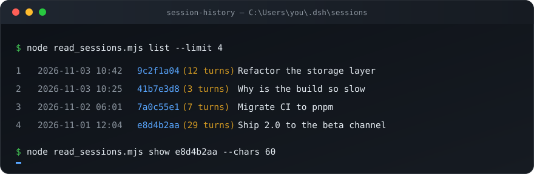

<div align="center">

# session-history

**Read your other DeepSeek Harness conversations — straight from the local session store.**

A [DSH](https://github.com/deepseek-ai/deepseek-harness) skill plus a zero-dependency CLI that
lists every past session on this machine and prints any transcript as clean, readable text.

[English](README.md) · [简体中文](README.zh-CN.md)

[](LICENSE)
[](https://nodejs.org)
[](#)
[](#)



</div>

---

## The problem

Every DSH conversation is persisted at

```
~/.dsh/sessions/<bucket>/session-<uuid>/session.v4.jsonl.zstd
```

The natural thing to do is decompress it. You get **one line** back — the session header — and
conclude the transcript is empty. It isn't. The file is **hundreds of concatenated zstd frames**,
one per flush: a 1 MB transcript can hold 645 frames and 1,250 records, while Node's
`zstdDecompressSync` only decodes the first frame and silently stops at the frame boundary.

`session-history` splits the file on the frame magic (`28 B5 2F FD`), extends the slice when a
candidate boundary lands inside a payload, parses the records, and hands you the conversation.

## Features

| | |
|---|---|
| **List sessions** | Newest first, with last activity, turn count, and the auto-generated session title |
| **Read transcripts** | User + assistant text in order; reasoning traces and tool traffic dropped |
| **Filter the noise** | Injected runtime context, skill catalogs, approval notices, and tool results are all `user/message` records — only genuine typed messages count |
| **Zero dependencies** | Node built-ins only (`fs`, `path`, `os`, `zlib`); nothing to install |
| **Any unique prefix works** | `e8d4b2aa` is enough to address a session; no UUID pasting |
| **Works as a DSH skill** | Drop the folder into `~/.dsh/skills/` and the agent can consult past conversations itself |

## Install

### As a DSH skill (recommended)

```bash
git clone https://github.com/GE66618/dsh-session-history.git \
  ~/.dsh/skills/session-history
```

On Windows, `%USERPROFILE%\.dsh\skills\session-history`. DSH watches that root, so the skill
shows up in the next session's catalog — no restart.

### As a standalone CLI

```bash
git clone https://github.com/GE66618/dsh-session-history.git
cd dsh-session-history
node read_sessions.mjs list
```

Requires Node.js 24+ (for `zlib.zstdDecompressSync`).

## Usage

```console
$ node read_sessions.mjs list --limit 4
 1  2026-11-03 10:42  9c2f1a04  (12 turns)  Refactor the storage layer
 2  2026-11-03 10:25  41b7e3d8  (3 turns)   Why is the build so slow
 3  2026-11-02 06:01  7a0c55e1  (7 turns)   Migrate CI to pnpm
 4  2026-11-01 12:04  e8d4b2aa  (29 turns)  Ship 2.0 to the beta channel
```

```console
$ node read_sessions.mjs show e8d4b2aa --chars 300
# e8d4b2aa-2f61-4c0d-9b7e-1a3f5d6c8e02  2026-11-01 12:04  Ship 2.0 to the beta channel
# cwd: C:\Users\you\Projects\acme-app

[user] the release job keeps failing at the signing step, can you take a look?

[assistant] On it. First let me see what the workflow actually runs, then work out
whether it is the keystore or the runner.

## What I found

The signing step reads four secrets, and two of them are missing on the
`release/*` branches, so GHA passes empty strings straight through.
```

> Every session shown in the examples is fictional.

| Command | What it does |
|---|---|
| `list [--limit N]` | Sessions, newest first (default 50) |
| `show <id-prefix> [--chars N]` | Transcript with each message clipped to `N` chars (default 400) |
| `show <id-prefix> --full` | Full message text, untruncated |

## How the store is shaped

Each line of the decompressed stream is one JSON record:

| Record | Meaning |
|---|---|
| `session` | Header: id, creation time, cwd, agent preset |
| `user/message` | Typed message — or an injected `runtime-context` / `skill-catalog` / `time-context` / `user-approval` record |
| `assistant/message` | Model output, including `reasoning` blocks |
| `tool/call`, `tool/result` | Tool traffic |
| `session/title` | LLM-generated title, with `source.kind` telling you whether it was a fallback |
| `turn/*`, `step/*`, `job/*`, `compaction/prune` | Lifecycle and bookkeeping |

Real user messages carry `data.source.kind === "user"`; everything else that arrives as a
`user/message` is injected context. That single filter is why turn counts and transcripts read
cleanly instead of being buried in system reminders.

## Privacy

Transcripts are **zstd-compressed but not encrypted**. Anything running as your OS user can read
every conversation on the machine, including model reasoning traces. Treat `~/.dsh/sessions` as
sensitive: don't sync it to a shared drive, and don't paste full transcripts into logs, issues, or
commits. This tool is read-only — it never writes to the store.

## Limits

- One OS user per run: sessions under another user profile or another machine are not reachable.
- The in-flight turn may not be flushed yet, so the newest session can look truncated.
- Discovery is one session store deep (`~/.dsh/sessions/*/*/session.v4.jsonl.zstd`); other DSH
  homes need `DSH_HOME` pointed at them (set the env var before running).

## License

[MIT](LICENSE) © 2026 GE66618