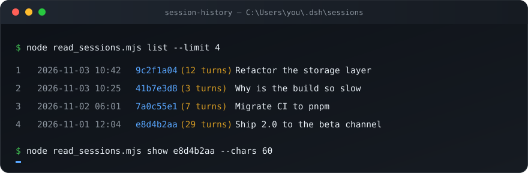

<div align="center">

# session-history

**读取你在 DeepSeek Harness 里的其他对话 —— 直接从本地会话存储里读。**

一个 [DSH](https://github.com/deepseek-ai/deepseek-harness) 技能，外加一个零依赖 CLI：
列出本机所有历史会话，并把任意一次对话还原成干净的纯文本。

[English](README.md) · [简体中文](README.zh-CN.md)

[](LICENSE)
[](https://nodejs.org)
[](#)
[](#)



</div>

---

## 它解决什么问题

DSH 把每次对话都存在这里：

```
~/.dsh/sessions/<bucket>/session-<uuid>/session.v4.jsonl.zstd
```

你最自然的反应是直接解压。结果只回来**一行**——会话头——于是你以为记录是空的。其实不是。
这个文件是**几百个首尾相接的 zstd 帧**，每次落盘追加一帧：一个 1 MB 的 transcript 里可能有
645 帧、1250 条记录，而 Node 的 `zstdDecompressSync` 只解第一帧，遇到帧边界就静默停下。

`session-history` 按帧魔数（`28 B5 2F FD`）切分文件，遇到候选边界落在压缩数据内部时自动向后
延展，解析出记录，再把对话还给你。

## 功能

| | |
|---|---|
| **列出会话** | 按最后活动倒序，附带轮数与会话标题（LLM 自动生成） |
| **读取正文** | 按顺序输出用户与助手文本；跳过推理轨迹与工具调用 |
| **过滤噪声** | 运行上下文、技能目录、审批提示、工具结果都是以 `user/message` 形式注入的，只有真正手打的才算数 |
| **零依赖** | 只用 Node 内置模块（`fs`、`path`、`os`、`zlib`），不用 `npm install` |
| **前缀寻址** | `e8d4b2aa` 就够定位一个会话，不用粘贴整串 UUID |
| **可作 DSH 技能** | 放进 `~/.dsh/skills/`，agent 自己就能翻你以前的对话 |

## 安装

### 作为 DSH 技能（推荐）

```bash
git clone https://github.com/GE66618/dsh-session-history.git \
  ~/.dsh/skills/session-history
```

Windows 下是 `%USERPROFILE%\.dsh\skills\session-history`。DSH 会监视这个根目录，下一个会话的
技能目录里就会出现它，不用重启。

### 作为独立 CLI

```bash
git clone https://github.com/GE66618/dsh-session-history.git
cd dsh-session-history
node read_sessions.mjs list
```

需要 Node.js 24+（为了 `zlib.zstdDecompressSync`）。

## 用法

```console
$ node read_sessions.mjs list --limit 4
 1  2026-11-03 10:42  9c2f1a04  (12 turns)  重构存储层
 2  2026-11-03 10:25  41b7e3d8  (3 turns)   构建为什么这么慢
 3  2026-11-02 06:01  7a0c55e1  (7 turns)   CI 迁移到 pnpm
 4  2026-11-01 12:04  e8d4b2aa  (29 turns)  2.0 发布到测试通道
```

```console
$ node read_sessions.mjs show e8d4b2aa --chars 300
# e8d4b2aa-2f61-4c0d-9b7e-1a3f5d6c8e02  2026-11-01 12:04  2.0 发布到测试通道
# cwd: C:\Users\you\Projects\acme-app

[user] 发布流水线一直卡在签名那步，你帮我看下？

[assistant] 好，先看这个工作流实际跑了什么，再判断是密钥库的问题还是 runner 的问题。

## 查到的情况

签名步骤读四个 secret，其中两个在 `release/*` 分支上是缺的，于是 GHA 直接传了空值。
```

> 示例里的会话全部是虚构的。

| 命令 | 作用 |
|---|---|
| `list [--limit N]` | 列出会话，最新在前（默认 50 条） |
| `show <id 前缀> [--chars N]` | 读取正文，每条消息截到 `N` 字（默认 400） |
| `show <id 前缀> --full` | 输出全文，不截断 |

## 存储结构长什么样

解压后的每一行都是一条 JSON 记录：

| 记录 | 含义 |
|---|---|
| `session` | 会话头：id、创建时间、cwd、agent preset |
| `user/message` | 用户消息——也可能是注入的 `runtime-context` / `skill-catalog` / `time-context` / `user-approval` |
| `assistant/message` | 模型输出，含 `reasoning` 推理块 |
| `tool/call`、`tool/result` | 工具调用与结果 |
| `session/title` | LLM 生成的标题，`source.kind` 说明是否为兜底生成 |
| `turn/*`、`step/*`、`job/*`、`compaction/prune` | 生命周期与记账记录 |

真正的用户消息带 `data.source.kind === "user"`，其余挂在 `user/message` 下的都是注入的上下文。
就是这一个过滤条件，让轮数和正文保持干净，而不是被系统提醒淹没。

## 隐私

这些记录只是 **zstd 压缩，并没有加密**。以你这个系统用户身份运行的任何程序，都能读到全部对话，
包括模型的推理过程。把 `~/.dsh/sessions` 当作敏感目录：不要同步到共享盘，也不要把完整 transcript
粘进日志、issue 或提交里。本工具是只读的，从不写入这个存储。

## 边界

- 只覆盖单个系统用户：其他用户目录、其他机器上的会话读不到。
- 正在进行的这一轮可能尚未落盘，最新会话看起来可能不完整。
- 只探查一个存储位置（`~/.dsh/sessions/*/*/session.v4.jsonl.zstd`）；换 DSH home 时先设置 `DSH_HOME`。

## 许可证

[MIT](LICENSE) © 2026 GE66618